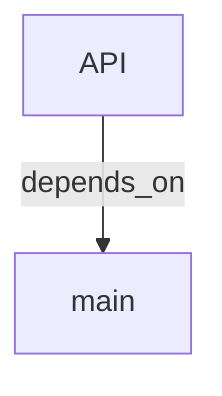

# Architecture exports

Three files, one source of truth:

| File | Audience | Rule |
| --- | --- | --- |
| `architecture-overview.md` | humans, PRs, Obsidian exports | readable, tables, wikilinks |
| `architecture-overview.json` | automation, dashboards | mirrors the Markdown content, no HTML |
| `architecture-overview.html` | no-install viewing | standalone, inline CSS, no CDN, no JS required |

All three derive from `buildArchitecture({graph, ledger, gaps, security})` in `scripts/lib/exports.mjs`. Never hand-edit one format without regenerating the others.

## Shared content model

```json
{
  "schema_version": 1,
  "project": "", "phase": "DURING", "revision": "",
  "generated_at": "",
  "derivation": { "available": false },
  "summary": { "nodes": 0, "edges": 0, "components": 0, "requirements": 0, "findings_confirmed": 0 },
  "coverage": {},
  "components": [], "requirements": [], "findings": [], "needs_validation": [],
  "risks": [], "decisions": [], "dependencies": [],
  "assumptions": [], "unknowns": [], "gaps": [], "next_actions": []
}
```

## Markdown sections

1. Title with project and revision.
2. Summary counts.
3. Coverage table.
4. Components table with wikilinks.
5. Requirements traceability with `(gap)` markers.
6. Security findings: **confirmed** table with severity; **needs validation** table with no severity column.
7. Risks/issues, decisions, dependencies.
8. Assumptions and unknowns.
9. Gaps.
10. Recommended next actions.

Wikilinks use `[[<note-id>\|<label>]]` (the pipe is escaped in Markdown tables).

## JSON

Same data, no presentation strings. Stable key order, 2-space indent, trailing newline. Suitable for CI diffing: only `generated_at`, coverage counts, and changed nodes should move.

## HTML

- One file, `<style>` inline, no network requests, no JavaScript.
- Reads in light and dark mode via `prefers-color-scheme`.
- Tables for components, traceability, and findings.
- Mermaid is **not** executed in the HTML export; the Mermaid source remains in the vault note and the Markdown file. Add a renderer later only if it stays dependency-free.
- All values HTML-escaped. No `innerHTML`-style injection paths.
- Same content as Markdown; if a section is omitted for layout reasons, that is a bug.

## Mermaid



- Node ids are prefixed `n_` and sanitized; labels are truncated to 60 chars.
- Top 30 nodes by degree; `contains` edges are omitted to keep diagrams readable.
- Broken Mermaid must fail the export, not silently render text.

## When to regenerate

| Change | Regenerate |
| --- | --- |
| `graph.json` changed | `export` |
| Only context requested | `context` |
| Hand-edited notes | never (outside managed blocks) |
| Ledger-only audit | `audit` writes the summary, not the exports |

`export` refuses to run without a valid `graph.json`; `mapkeeper doctor` verifies all four artifacts exist.